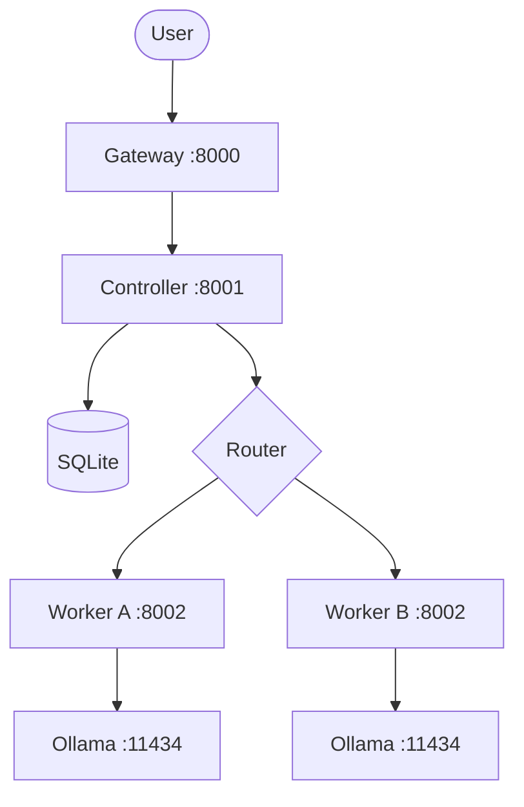

# lfhai: Local-First Heterogeneous AI Runtime

lfhai is a distributed, local-first compute fabric and runtime designed to coordinate mismatched, resource-constrained consumer hardware into a unified AI system. Rather than relying on uniform cluster topologies (like homogeneous GPU nodes), lfhai abstracts heterogeneous hardware—such as standard consumer GPUs, older CPUs, mobile devices, and shared local servers—into a single execution layer.

**Status: V1 Implemented** - Core routing, node registration, heartbeat monitoring, worker auth, CLI, multi-endpoint RPC memory pooling, GGUF-aware planning, LAN discovery, and native RPC bridges for Android/iOS are working. 81 tests passing, 2 skipped (unit + live end-to-end cluster tests against stub backends). Real llama.cpp RPC pooling, `--fit-target`, and tensor/KV offload were verified with a 15M GGUF.

---

## Quick Start

```bash
# Install
git clone https://github.com/pranavkhaspa/lfhai.git
cd lfhai
pip install -e .

# Start the controller
lfh controller

# Mint a one-time join token (prints an lfh node join <token> command)
lfh token create

# On each worker machine, run the printed command to join, then:
lfh worker start

# Submit a chat request
lfh chat llama3 "What is the capital of France?"

# Check cluster status
lfh status
```

---

## Running a 70B model across devices

Ollama does **not** shard one model across machines; it only streams tokens and splits
within a single machine. For a 70B-class model that does not fit on one device, lfhai
uses llama.cpp's RPC backend: each helper exposes free RAM/VRAM over a private LAN,
and the coordinator runs `llama-server --rpc ...` so weights, layer compute and KV
cache are distributed across the pool.

Requirements:

- llama.cpp built with RPC support (`-DGGML_RPC=ON`), providing `llama-server` and `rpc-server`/`ggml-rpc-server`
- a quantized GGUF copy of the model on the coordinator (e.g. 70B Q4_K_M ≈ 40 GiB)
- combined advertised RPC capacity ≥ `GGUF runtime estimate × 1.18` (the planner checks this before dispatch)
- a trusted private network — llama.cpp RPC is **not authenticated or encrypted**

```bash
# CPU contributor (desktop, laptop, Android node, UNO Q):
lfh worker start -c http://controller:8001 \
  --advertise-ip 192.168.1.11 \
  --rpc-cpu --rpc-bind 192.168.1.11 \
  --rpc-cpu-memory-mb 1536 --rpc-cpu-port 50053

# GPU contributor:
lfh worker start -c http://controller:8001 \
  --advertise-ip 192.168.1.12 \
  --rpc-gpu --rpc-bind 192.168.1.12 \
  --rpc-gpu-memory-mb 9000 --rpc-gpu-port 50052

# On the device holding the GGUF file:
lfh worker start -c http://controller:8001 \
  --advertise-ip 192.168.1.10 \
  --model-dir /models --llamacpp-bin /path/to/llama-server

# Inspect the plan, then chat/stream normally:
lfh discover
lfh plan llama3:70b
lfh chat llama3:70b --stream "Explain distributed inference"
```

The worker advertises each RPC lane separately, sets `GGML_RPC_NO_COMM=1` by default,
supervises RPC processes on each heartbeat, and retries with fewer peers if a
`llama-server --rpc` startup fails. `lfh plan` shows the chosen strategy
(`ollama`, `llamacpp`, or `rpc_pool`), the fit-target MiB, GGUF-aware memory estimate,
and every RPC endpoint whose memory will be pooled.

---

## What V1 Includes

| Component | Status | Description |
|-----------|--------|-------------|
| **Controller** | Working | Node registry (SQLite), heartbeat tracking, task routing |
| **Worker** | Working | Ollama integration, capability detection, multi-lane RPC supervision, task execution |
| **Gateway** | Working | OpenAI-compatible HTTP API (streaming + non-streaming) |
| **CLI** | Working | `lfh` command: status, chat, nodes, models, worker start |
| **Router** | Working | Planner-based placement with free RAM/VRAM accounting |
| **70B RPC pool** | Working | GGUF-aware planning, fit targets, multi-backend endpoints, fallback, streaming via llama.cpp RPC |
| **Tailcat** | Verified (real binary) | Encrypted tunnel wrapper — `serve --json`/`ping` tested against the real tailcat binary |
| **RPC pool** | Verified (real binary) | `ggml-rpc-server` + `llama-server --rpc --fit-target` offloaded 7/7 layers to RPC0 |
| **Apps** | Dev builds | Android JNI and iOS `lfhai_rpc_start` native bridges build from llama.cpp |
| **Tests** | 81 passing, 2 skipped | Unit + live E2E (controller+worker+gateway against stub Ollama/llama-server) |
| **install.sh** | Ready | Worker provisioning script (Ollama + lfhai + systemd) |

### What V1 Does NOT Include (Future)

- DAG scheduling (requests go to single best node, no graph splitting)
- Raft consensus (single controller, SQLite-backed)
- Tailscale mesh (direct HTTP, tailcat available as opt-in)
- Semantic caching (exact-match routing only)
- RAG / embedding support
- Dashboard / web UI
- Signed Android/iOS store releases
- Guardrails / content filtering

---

## Architecture (V1)

```
User (HTTP) --> Gateway (:8000) --> Controller (:8001)
                                          |
                                    SQLite Registry
                                    Task Router
                                          |
                                    Worker (:8002)
                                          |
                                    Ollama (:11434)
```



---

## CLI Reference

```
lfh status                    # Show cluster health
lfh nodes                     # List all registered nodes
lfh models                    # List available models across cluster
lfh chat <model> <prompt>     # Submit a chat request
lfh chat --stream <model> <prompt>  # Stream response
lfh plan <model>              # Show placement/RPC shard plan + fit target
lfh discover                  # Find workers advertising on the LAN
lfh worker start              # Start worker; add --rpc-cpu/--rpc-gpu for pooling
lfh worker status             # Check local worker status and RPC lanes
lfh controller                # Start the controller
lfh gateway                   # Start the gateway
```

---

## Cluster Authentication

lfhai uses one-time **join tokens** to admit machines; no accounts or
sign-ups required (perfect for private clusters on your own hardware).

1. On the controller machine: `lfh token create` — prints a single
   `lfh node join HOST:PORT:SECRET` command.
2. On each worker machine: run that exact command once.

What that gives you:

- **No IP hunting or port config** — the token carries the controller
  address and secret, so onboarding is one paste per machine.
- **Single-use tokens** — each token admits one machine, then dies.
- **Expiry** — tokens default to a 1-hour lifetime (`--ttl-hours` on `lfh token create`).
- **Hashed at rest** — the controller stores only SHA-256 hashes of tokens
  and node secrets, never plaintext.
- **Server-assigned identities** — the controller generates each node's ID,
  and the worker stores its credential in `~/.lfhai/credentials.json` (0600).
- **Authenticated nodes** — worker registration and heartbeats require the
  node secret; `lfh token list` / `lfh token revoke` manage tokens.

Out of scope for V1: TLS between nodes and authenticated worker endpoints
are planned for V2 networking.

---

## API Endpoints

### Gateway (port 8000)
| Method | Endpoint | Description |
|--------|----------|-------------|
| POST | `/v1/chat/completions` | OpenAI-compatible chat completions |
| GET | `/v1/models` | List available models |
| GET | `/v1/nodes` | List cluster nodes |
| GET | `/health` | Health check |

### Controller (port 8001)
| Method | Endpoint | Description |
|--------|----------|-------------|
| POST | `/api/v1/nodes/join` | Admit a node with a one-time join token |
| POST | `/api/v1/nodes/register` | Register a worker node (Bearer node secret required) |
| POST | `/api/v1/nodes/heartbeat` | Send heartbeat telemetry (Bearer node secret required) |
| GET | `/api/v1/nodes` | List all nodes |
| GET | `/api/v1/nodes/{id}` | Get node details |
| DELETE | `/api/v1/nodes/{id}` | Remove a node |
| POST | `/v1/chat/completions` | Route chat to best worker |
| GET | `/v1/models` | List all models |
| GET | `/api/v1/tasks/{id}` | Get task status |

### Worker (port 8002)
| Method | Endpoint | Description |
|--------|----------|-------------|
| GET | `/worker/status` | Worker status + capabilities |
| POST | `/worker/task` | Execute inference task |
| GET | `/health` | Health check |

---

## Development

```bash
# Install with dev dependencies
pip install -e ".[dev]"

# Run tests
python -m pytest tests/ -v

# Lint
ruff check lfhai/ tests/

# Format
ruff format lfhai/ tests/
```

---

## Project Structure

```
lfhai/
├── lfhai/
│   ├── __init__.py         # Package init
│   ├── models.py           # Shared data models (Pydantic)
│   ├── controller.py       # Cluster controller + HTTP API
│   ├── worker.py           # Worker daemon + Ollama proxy
│   ├── gateway.py          # User-facing HTTP gateway
│   ├── router.py           # Legacy capability-based fallback router
│   ├── planner.py          # GGUF-aware placement + RPC memory-pool planning
│   ├── gguf.py             # Clean-room GGUF header reader
│   ├── discovery.py        # LAN discovery beacons
│   ├── ollama.py           # Ollama API client
│   ├── registry.py         # SQLite node registry + task store
│   ├── tailcat.py          # Tailcat encrypted tunnel wrapper
│   └── cli.py              # lfh CLI tool
├── tests/
│   ├── test_models.py       # Model tests (7)
│   ├── test_registry.py     # Registry tests (16)
│   ├── test_router.py       # Router tests (3)
│   ├── test_planner.py      # 70B placement/RPC pool tests (7)
│   ├── test_gguf.py         # GGUF parser tests (2)
│   ├── test_discovery.py    # LAN discovery tests (2)
│   ├── test_controller.py   # Controller API tests (18)
│   ├── test_worker.py       # Worker RPC + dispatch tests (11)
│   └── e2e/                 # Live cluster + RPC pool tests (3)
├── apps/
│   ├── android/             # Kotlin node app + JNI/llama.cpp RPC native build
│   └── ios/                 # Swift node client + llama.cpp RPC native library
├── packaging/
│   ├── linux/               # Linux node package build + service
│   └── uno-q/               # UNO Q CPU-node setup
├── .github/workflows/ci.yml # CI matrix: core, Linux, Android, iOS
├── pyproject.toml          # Project config
├── install.sh              # Worker provisioning script
└── V1_PLAN.md              # V1 implementation plan
```

---

## Hardware Requirements

### Minimum V1 Cluster (2 nodes)

**Controller Node:**
- Any machine with Python 3.10+
- 2+ CPU cores, 4GB RAM
- Runs: controller + gateway

**Worker Node:**
- Machine with Ollama installed
- GPU recommended (NVIDIA CUDA) but **CPU-only works fully** — Ollama has a
  CPU mode, and the router prefers whichever ONLINE node advertises the
  requested model (GPU is a tie-breaker, never a requirement)
- Runs: worker daemon + Ollama

### Releases and supported platforms

Pushing a `v*` tag publishes GitHub Release artifacts via
`.github/workflows/release.yml`:

- `lfhai-<version>.apk` — Android debug APK for contributor devices
- `lfhai-linux-x86_64-<version>.tar.gz` — portable Linux CLI + `llama-server` + `ggml-rpc-server`
- `lfhai-windows-x86_64-<version>.zip` — portable Windows CLI + `llama-server.exe` + `ggml-rpc-server.exe`
- `lfhai-<version>-py3-none-any.whl` — Python wheel used by `install.sh`

The runtime is pure Python and also works on Linux, macOS, and Windows with Ollama.
For portable bundles, set environment variables and run the bundled launcher:

```bash
# Linux
export LFHAI_CONTROLLER="http://100.x.y.z:8001"
export LFHAI_RPC_BIND="100.x.y.z"
export LFHAI_RPC_CPU_MEMORY_MB=1536
export LFHAI_MODEL_DIR="$PWD/models"
./run-worker.sh
```

```powershell
# Windows
$env:LFHAI_CONTROLLER = "http://100.x.y.z:8001"
$env:LFHAI_RPC_BIND = "100.x.y.z"
$env:LFHAI_RPC_CPU_MEMORY_MB = 1536
.\run-worker.ps1
```

Install the Android APK, paste the controller token as `HOST:PORT:SECRET`, and
the app will join and expose a CPU RPC endpoint. A Tailscale `100.x.y.z` host
works as `HOST`.

### Tailscale for distant / out-of-network nodes

LAN discovery is local-only; across Tailscale, use the tailnet IP explicitly.
Install and join Tailscale locally, then use that IP in the controller token,
`LFHAI_CONTROLLER`, and `LFHAI_RPC_BIND`. Never put auth keys in the repo.

```bash
# Linux, with key kept in your shell environment
TAILSCALE_AUTHKEY="tskey-..." ./scripts/setup-tailscale.sh

# Windows PowerShell
$env:TAILSCALE_AUTHKEY = "tskey-..."
.\scripts\setup-tailscale.ps1
```

Allow TCP `8000`, `8001`, `8002`, `50052`, and `50053` between Tailscale peers.
The controller URL printed by `lfh token create` should use the controller's
tailnet IP.

### UNO Q Wi-Fi and worker setup

Keep Wi-Fi credentials in a local file that is never committed:

```bash
cp packaging/uno-q/lfhai-wifi.env.example packaging/uno-q/lfhai-wifi.env
# edit WIFI_SSID, WIFI_PASSWORD, and optional LFHAI_ADVERTISE_IP
LFHAI_WIFI_ENV=packaging/uno-q/lfhai-wifi.env \
  bash packaging/uno-q/setup.sh "100.x.y.z:8001:SECRET" 100.x.y.z
```

`setup.sh` joins Wi-Fi first, then installs the worker with a CPU RPC lane on
port `50053` and advertises the selected IP.

---

## Roadmap

### V1 (Current) - Basic Routing
- [x] Node registration + heartbeat
- [x] Capability-aware routing
- [x] Ollama integration
- [x] OpenAI-compatible API
- [x] CLI tool
- [x] CPU-only worker support (Ollama CPU mode)
- [x] Worker dispatch authentication (per-node secrets)
- [x] 70B-class placement and llama.cpp RPC memory pooling
- [x] Live multi-node E2E test (81 passing, 2 skipped)

### V2 - Networking
- [x] Tailcat tunnel integration (verified against the real binary)
- [x] Tailscale setup scripts and tailnet-IP worker advertising
- [ ] Multi-controller support
- [ ] Node-to-node direct communication

### V3 - Intelligence
- [ ] DAG scheduling (multi-step prompts)
- [ ] Semantic caching
- [ ] RAG support
- [ ] Embedding routing

### V4 - Scale
- [ ] Dashboard / web UI
- [ ] Raft consensus
- [x] Android / mobile nodes (debug APK releases)
- [ ] Guardrails
